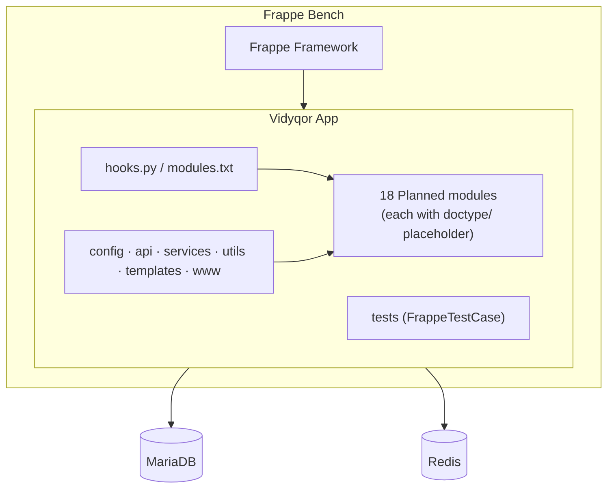

<div align="center">


# Vidyqor

### Open Source Education ERP

**One Platform. Every Institution.**

[](LICENSE)
[](https://github.com/whoami4101/Vidyqor/stargazers)
[](https://github.com/whoami4101/Vidyqor/network/members)
[](https://github.com/whoami4101/Vidyqor/issues)
[](https://github.com/whoami4101/Vidyqor/releases)
[](https://github.com/whoami4101/Vidyqor/actions/workflows/ci.yml)
[](https://www.python.org/)
[](https://frappeframework.com)

</div>

> **Note:** Vidyqor is at the **foundation / scaffold** stage. The badges above read live data
> from this repository, so a release or CI badge may show "no release" / "no status" until one
> exists. **CI has not yet run on this repository** — the workflows are defined but no run has
> been triggered, and no version has been released. All 18 functional modules are **Planned**;
> only the project foundation / scaffold is present.

---

## Introduction

Vidyqor is an open source **Education ERP** built on the
[Frappe Framework](https://frappeframework.com). The goal is a single, self-contained platform
that institutions — schools, colleges, universities, and training centers — can use to run
their administration end to end, without depending on ERPNext or other Frappe apps.

This repository currently contains the project foundation: the Frappe app package layout,
build configuration, tooling, CI/lint/release workflows, and documentation. The functional
modules have not been implemented yet.

## Objectives

- Provide one coherent platform covering the full institution lifecycle.
- Stay a single, independent Frappe app (`required_apps = []`) that is easy to install.
- Follow Frappe conventions so the project is familiar to the Frappe community.
- Build in the open with honest status reporting — no fabricated progress.
- Keep the codebase well-tested, linted, and documented from the foundation up.

## Why Vidyqor

- **Purpose-built for education**, rather than a general ERP bent to fit institutions.
- **Open source (MIT)** — inspect, extend, and self-host freely.
- **Frappe-native** — benefits from Frappe's permission system, DocTypes, and tooling.
- **Independent** — no heavy dependency chain to install or maintain.
- **Transparent roadmap** — implemented, in-development, and planned work are clearly separated.

## Main features

> All feature areas below are **Planned**. See the status table for the authoritative state.

- Institution, department, and faculty administration.
- Student lifecycle: admissions, enrollment, academics, attendance, and examinations.
- Finance and fee management.
- Support services: library, hostel, transport, and placements.
- Human resources, communication, and document management.
- Reporting, analytics, and system configuration.

## Module overview

Vidyqor is organized into 18 functional modules. A full description of each is in
[docs/modules/module-overview.md](docs/modules/module-overview.md).

Institution, Student, Admission, Academic, Department, Faculty, Attendance, Examination,
Finance & Fee, Library, Hostel, Transport, Placement, Human Resource, Communication, Document,
Reports & Analytics, and System Configuration.

## Feature implementation status

The only thing present today is the project foundation. Every functional module is **Planned**.

| Area | Status |
| --- | --- |
| Project foundation / scaffold | ✅ Present |
| Institution Management | 🔲 Planned |
| Student Management | 🔲 Planned |
| Admission Management | 🔲 Planned |
| Academic Management | 🔲 Planned |
| Department Management | 🔲 Planned |
| Faculty Management | 🔲 Planned |
| Attendance Management | 🔲 Planned |
| Examination Management | 🔲 Planned |
| Finance And Fee Management | 🔲 Planned |
| Library Management | 🔲 Planned |
| Hostel Management | 🔲 Planned |
| Transport Management | 🔲 Planned |
| Placement Management | 🔲 Planned |
| Human Resource Management | 🔲 Planned |
| Communication Management | 🔲 Planned |
| Document Management | 🔲 Planned |
| Reports And Analytics | 🔲 Planned |
| System Configuration | 🔲 Planned |

## Technology stack

| Layer | Technology |
| --- | --- |
| Framework | [Frappe Framework](https://frappeframework.com) |
| Language | Python 3.10+ |
| Database | MariaDB (PostgreSQL also supported by Frappe) |
| Cache / queue | Redis |
| Frontend assets | Node.js (via Frappe) |
| Build backend | [flit_core](https://flit.pypa.io) (dynamic version) |
| Lint / format | [Ruff](https://docs.astral.sh/ruff/), [Prettier](https://prettier.io), markdownlint |

## Architecture



See [docs/architecture/overview.md](docs/architecture/overview.md) for details.

## Installation

Vidyqor is a Frappe app. Inside a working
[Frappe Bench](https://docs.frappe.io/framework/user/en/installation):

```bash
bench get-app https://github.com/whoami4101/Vidyqor
bench --site your-site.localhost install-app vidyqor
```

To validate the scaffold without a Frappe runtime:

```bash
python3 -m compileall vidyqor
bash scripts/validate_scaffold.sh
```

Full details: [docs/installation/installation.md](docs/installation/installation.md).

## Development setup

```bash
git clone https://github.com/whoami4101/Vidyqor
cd Vidyqor

pip install pre-commit
pre-commit install
pre-commit run --all-files
```

See [docs/development/development-environment.md](docs/development/development-environment.md)
and [CONTRIBUTING.md](CONTRIBUTING.md).

## Screenshots

No screenshots yet — the application UI has not been built. Screenshots will be added as
modules are implemented.

## Roadmap

No version has been released yet. The roadmap below is indicative and subject to change.

| Milestone | Focus | Status |
| --- | --- | --- |
| v0.1.0 | Project foundation / scaffold | In progress (unreleased) |
| v0.2.0 | Institution, Department, Faculty foundations | Planned |
| v0.3.0 | Student, Admission, Academic modules | Planned |
| v0.4.0 | Attendance, Examination modules | Planned |
| v0.5.0 | Finance & Fee management | Planned |
| v0.6.0 | Library, Hostel, Transport, Placement | Planned |
| v0.7.0 | HR, Communication, Document management | Planned |
| v0.8.0 | Reports & Analytics, System Configuration | Planned |
| v1.0.0 | Stable, production-ready release | Planned |

See [CHANGELOG.md](CHANGELOG.md) for recorded changes.

## Contributing

Contributions are welcome. Please read [CONTRIBUTING.md](CONTRIBUTING.md) and our
[Code of Conduct](CODE_OF_CONDUCT.md). Use the issue forms to report bugs or request features,
and the [pull request template](.github/PULL_REQUEST_TEMPLATE.md) for changes.

## Security

Do not open public issues for security reports. Use GitHub's
[private vulnerability reporting](https://github.com/whoami4101/Vidyqor/security). See
[SECURITY.md](SECURITY.md) for the full policy.

## License

Vidyqor is released under the [MIT License](LICENSE). Copyright (c) 2026 Vidyqor Community.

## Acknowledgements

- [Frappe Framework](https://frappeframework.com) — the foundation Vidyqor is built on.
- [Contributor Covenant](https://www.contributor-covenant.org) — the basis for our Code of Conduct.
- Everyone in the community who contributes ideas, code, and documentation.

## Community

- **Issues:** <https://github.com/whoami4101/Vidyqor/issues>
- **Discussions:** <https://github.com/whoami4101/Vidyqor/discussions>
- **Support:** [SUPPORT.md](SUPPORT.md)
